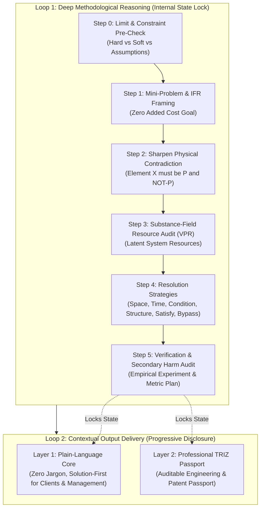

# 🏛️ TRIZ Universal: Open-Source AI Architecture & Inventive Consultant

[](https://opensource.org/licenses/MIT)
[](https://www.python.org/downloads/)
[](https://dev.to/challenges/hacktoberfest-week2-2026-10-12)
[]()
[]()

> **Solve impossible architectural trade-offs without buying expensive enterprise tiers or leaking client IP.**  
> Powered by classical **TRIZ (ARIZ-AI)** and **Open-Source AI** (Gemma 2, Ollama, local open-weight models).

---

## 💡 The "Side Hustle" Dilemma

When freelancers, solo-founders, and small engineering teams build products, they hit painful architectural deadlocks:
* *"We need offline-first speed, but distributed multi-device sync causes conflicts and requires an expensive locking cluster."*
* *"We need 10,000 requests/sec during viral launches, but we can't afford a $1,000/mo AWS enterprise RDS/Redis bill."*
* *"We need continuous medical IoT sensor telemetry, but the coin-cell battery dies in 8 hours."*

Traditional consulting costs **$150–$300/hour**, while standard AI assistants default to lazy middle-ground compromises (*"just add Redis"*, *"buy another server"*, *"drop one of your requirements"*).

**TRIZ Universal** transforms how technical consultants and solo builders operate. It implements the classical Soviet Theory of Inventive Problem Solving (**ТРИЗ / ARIZ-AI**) directly inside a local, open-source AI agent:
1. **Zero Compromise:** Never weakens a hard requirement. It sharpens the conflict into an atomic **Physical Contradiction** and resolves it.
2. **$0 Marginal Cost:** Mandates an **Ideal Final Result (IFR)** and audits **Substance-Field Resources (VPR)** to solve problems using latent system capabilities already present.
3. **100% Data & IP Privacy:** Runs completely offline or on local open-weight models (**Gemma 2**, **Llama 3**). No sensitive patent ideas, proprietary schemas, or customer data ever leave your laptop.

---

## ⚡ The Dual-Loop ARIZ-AI Architecture

TRIZ Universal implements a strict **Dual-Loop Execution Pipeline** designed to prevent post-hoc rationalizations:



---

## 🚀 Quickstart

### 1. Installation

```bash
git clone https://github.com/torrua/triz-universal.git
cd triz-universal
pip install -e .
```

### 2. Run the Interactive CLI

Resolve any technical contradiction in your terminal:

```bash
# Interactive solver
triz solve

# Or provide parameters directly
triz solve \
  --problem "High database read concurrency locks write transactions" \
  --param-a "Read Throughput" \
  --param-b "Database Memory & CPU Cost"
```

### 3. Generate a High-Value Consulting Report (Side Hustle Mode)

Generate a complete **Architectural Audit & Roadmap** for a client project:

```bash
# Run one of the pre-built client archetypes
triz consult --template freelancer_offline_sync --out report.md

# Or launch interactive client intake
triz consult
```

### 4. Interactive Contradiction Matrix

Look up classical Altshuller principles mapped to modern software & business equivalents:

```bash
# Look up contradiction: Speed (9) vs Memory (1)
triz matrix --improve 9 --worsen 1

# Search parameters by keyword
triz matrix --search latency
```

### 5. Launch the Web UI

```bash
triz serve --port 8000
```
Open `http://localhost:8000` to access the interactive web dashboard with real-time template loading and Markdown export.

---

## 🧠 Open-Source AI Engine (How it Works)

TRIZ Universal is designed around **Open Innovation** and supports multiple execution backends:

| Backend | Environment | Best For | Privacy |
|---|---|---|---|
| **Ollama (Gemma 2 / Llama 3)** | Local (`http://localhost:11434`) | Production local consulting, solo-founders | 🔒 100% Local (Zero data leakage) |
| **Deterministic Offline Engine** | Zero-dependency fallback | Instant testing, air-gapped environments | 🔒 100% Offline (No LLM needed) |
| **OpenAI-Compatible Local APIs** | LM Studio, vLLM, llama.cpp | Self-hosted GPU servers | 🔒 Self-hosted |
| **Google Gemma / Gemini API** | `GEMMA_API_KEY` or `GEMINI_API_KEY` | Cloud fallback | Cloud |

### Running with Gemma 2 on Ollama:
```bash
# In another terminal:
ollama run gemma2

# TRIZ Universal automatically detects Ollama at http://localhost:11434
triz solve
```

---

## 💼 Side Hustle Case Studies

The `examples/` directory contains complete end-to-end consulting audit scripts for 3 common client dilemmas:

### Case 1: Freelance Offline Mobile Invoicing Sync (`examples/freelance_db_sync.py`)
* **Client:** LocalCraft Freelance Field Services.
* **Problem:** Field technicians need instant receipt/invoice creation without network delays, but syncing across devices causes merge conflicts and traditionally requires expensive distributed lock servers.
* **TRIZ Solution:** Separation in Time & Structure (Principles #4 Asymmetry, #10 Preliminary Action, #2 Extraction). Uses a local append-only log with deterministic conflict resolution (CRDTs) and background batch reconciliation. **Savings: $0 cloud locking servers.**

### Case 2: Solo Founder 10k RPS Scale on $20/month (`examples/solo_founder_scale.py`)
* **Client:** Bootstrapped Micro-SaaS.
* **Problem:** Sudden viral launch traffic threatens to crash the single VPS database, but the founder cannot afford enterprise database clusters.
* **TRIZ Solution:** Principle #28 (Mechanics Substitution) & Principle #10 (Preliminary Action). Exploits OS kernel page cache and pre-rendered edge caching to serve 98% of read traffic without touching the database process.

### Case 3: Continuous IoT Telemetry vs Battery (`examples/iot_wearable_battery.py`)
* **Client:** BioSense Wearables.
* **Problem:** Clinical safety requires continuous patient monitoring, but BLE transmission drains a coin-cell battery in 8 hours.
* **TRIZ Solution:** Principle #19 (Periodic Action) & Principle #16 (Partial/Excessive Action). Implements on-device edge anomaly delta filtering: transmits only statistical deviations while buffering normal heartbeats locally. **Battery life increased from 8 hours to 34 days.**

---

## 📦 Using as an Agent Skill

This repository also hosts the upstream source for the `triz-universal` agent skill. You can directly install it into **Google Antigravity**, **Claude Code**, **Cursor**, or other coding agents:

Copy the folder `skills/triz-universal` into your agent's config directory:
```text
~/.gemini/config/skills/triz-universal/
  ├── SKILL.md                          # Primary instruction bundle & ARIZ pipeline
  └── references/                       # 16 deep reference manuals & catalogs
      ├── 01-ikr-ideality.md
      ├── 02-contradictions.md
      ├── 03-separation-principles.md
      ├── 05-40-principles-catalog.md
      ├── 11-contradiction-matrix.md
      └── ariz-deep/                    # Canonical ARIZ-85-V analysis & resolution
```

---

## 🧪 Testing

Run the automated test suite:

```bash
python -m pytest tests
```

---

## 📜 License

Distributed under the **MIT License**. See [LICENSE](LICENSE) for details.

---

## 🏆 Hacktoberfest 2026 Open-Source AI Challenge

Built with pride for the **[Hacktoberfest Open-Source AI Challenge: Week 2 (Side Hustle)](https://dev.to/challenges/hacktoberfest-week2-2026-10-12)**.  
Author: [@torrua](https://github.com/torrua)  
Read our submission post on DEV.to: [DEV_POST.md](DEV_POST.md)
