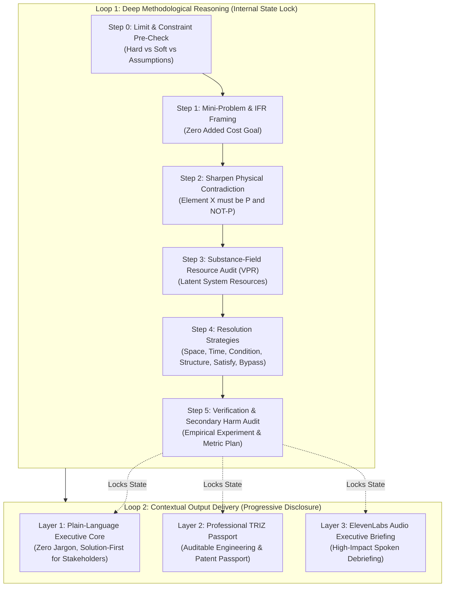

# 🏛️ Genrikh: Universal Inventive Problem Solver on Open-Source AI

[](https://opensource.org/licenses/MIT)
[](https://www.python.org/downloads/)
[](https://dev.to/challenges/hacktoberfest-week2-2026-10-12)
[]()
[]()
[](https://sentry.io/)
[](https://render.com)
[](https://elevenlabs.io/)

> **Solve impossible trade-offs across Software, Physical Engineering, and Business without compromise, expensive enterprise tiers, or leaking intellectual property.**  
> Named in honor of **Genrikh Saulovich Altshuller (1926–1998)**, the founder of TRIZ (Theory of Inventive Problem Solving).  
> Powered by classical **ARIZ-AI**, local open-weight models (**Google Gemma 2**), **Sentry Agent Tracing**, **Render 1-Click Deploy**, and **ElevenLabs Voice Briefings**.

---

## 💡 The Philosophy of Genrikh Altshuller

In 1946, Soviet inventor and researcher **Genrikh Altshuller** set out to answer a fundamental question: *Can the process of invention be taught as an exact science?*

After analyzing hundreds of thousands of patents worldwide, Altshuller uncovered a profound truth:
> **Real innovation is NOT compromise.**  
> Conventional thinking resolves conflicting requirements by meeting in the middle (e.g. degrading quality to save costs, buying more hardware to handle bad code, sacrificing battery for compute).  
> **True inventive thinking sharpens the conflict into an atomic Physical Contradiction and eliminates it completely using latent resources already present in the system.**

Today, standard LLMs default to lazy middle-ground compromises (*"just add Redis"*, *"buy a larger AWS cluster"*, *"drop your precision"*).

**Genrikh** brings Altshuller's rigorous methodology into the era of modern AI:
1. **Universal Problem Scope:** From distributed database synchronization to IoT hardware battery life and organizational scaling bottlenecks.
2. **Strict Dual-Loop ARIZ-AI Pipeline:** Guarantees zero compromise through an internal **State Lock** before presenting solutions.
3. **$0 Marginal Cost:** Mandates the **Ideal Final Result (IFR)** and leverages latent **Substance-Field Resources (VPR)** to solve problems with zero added cost.
4. **100% Privacy & Air-Gapped IP:** Runs locally on **Gemma 2** via Ollama or standalone offline heuristics. Not a single byte of trade secret leaves your machine.

---

## ⚡ The Dual-Loop ARIZ-AI Architecture

To eliminate AI hallucinations and post-hoc rationalizations, Genrikh enforces a strict **Dual-Loop Execution Pipeline**:



### Sentry Agent Tracing
Every step in Loop 1 and Loop 2 is instrumented with **Sentry Agent Tracing** (`sentry_sdk.start_span` / `trace_ariz_step`). Inspect reasoning latencies, prompt token counts, state lock integrity, and error boundaries in real-time.

---

## 🏆 Hacktoberfest 2026 Partner Integrations

Genrikh proudly demonstrates deep integration across four major open-source and developer ecosystems:

| Track / Partner | Integration in Genrikh | Module |
|---|---|---|
| **Google Gemma** | Native Gemma 2 canonical chat formatting (`<start_of_turn>`), local Ollama execution, and cloud fallback via Google GenAI SDK. | `genrikh/gemma.py`, `genrikh/engine.py` |
| **Sentry** | AI Agent Tracing across all 5 ARIZ reasoning steps, tracking agent tokens, execution spans, and state lock contexts. | `genrikh/tracing.py` |
| **Render** | Production-ready 1-click cloud deployment with `render.yaml` infrastructure-as-code and lightweight multi-stage `Dockerfile`. | `render.yaml`, `Dockerfile` |
| **ElevenLabs** | Spoken audio debriefs generated automatically from Layer 1 solutions for non-technical stakeholders and client pitches. | `genrikh/voice.py` |

---

## 🚀 Quickstart

### 1. Installation

```bash
git clone https://github.com/torrua/triz-universal.git
cd triz-universal
pip install -e .
```

Both `genrikh` and `triz` CLI commands are registered and interchangeable!

### 2. Interactive Contradiction Solver

Solve an impossible technical deadlock in your terminal:

```bash
# Interactive solver
genrikh solve

# Direct CLI parameters
genrikh solve \
  --problem "High database read throughput causes locking and latency spikes on writes" \
  --param-a "Read Concurrency" \
  --param-b "Write Latency & Storage Cost"
```

### 3. High-Value Consulting Report Generator

Generate an executive architectural roadmap or patent bypass audit:

```bash
# Generate report from pre-built client archetypes
genrikh consult --template freelancer_offline_sync --out report.md

# Generate report with ElevenLabs executive audio briefing
genrikh consult --template solo_founder_scale --voice --voice-out briefing.mp3
```

### 4. Interactive Altshuller Matrix Explorer

Explore the classical 39x39 Altshuller Matrix mapped to modern software, hardware, and business systems:

```bash
# Find principles resolving Speed (9) vs Reliability (27)
genrikh matrix --improve 9 --worsen 27

# Search matrix parameters by keyword
genrikh matrix --search latency
```

### 5. Launch the Web UI

```bash
genrikh serve --port 8000
```
Open `http://localhost:8000` for an interactive browser dashboard with template loading, instant solver previews, and Markdown report downloads.

---

## 🌐 Deploy to Render in 1 Click

Genrikh includes a declarative `render.yaml` blueprint:

1. Fork or push this repository to GitHub.
2. In the [Render Dashboard](https://dashboard.render.com/), choose **New Blueprint Instance**.
3. Connect your repository. Render automatically builds the `Dockerfile` and deploys the FastAPI web application.
4. (Optional) Set `SENTRY_DSN` and `ELEVENLABS_API_KEY` in your Render Environment Variables for live telemetry and audio generation.

---

## 🔬 Gemma 2 Benchmark Results

Run the built-in benchmark to evaluate Gemma 2's reasoning across diverse domains:

```bash
python examples/gemma2_benchmark.py
```

### Benchmark Highlights:
* **Domain 1: Software Architecture** (Offline Distributed Sync)
  * *Contradiction:* Local Instant Mutability vs Global Consistency.
  * *Resolved via:* Principles #4 (Asymmetry), #10 (Preliminary Action), #2 (Extraction).
  * *Impact:* $0 cloud locking infrastructure, 0ms local mutation latency.
* **Domain 2: Physical / IoT Engineering** (Wearable Sensor Telemetry)
  * *Contradiction:* High Medical Sampling Frequency vs Battery Energy Drain.
  * *Resolved via:* Principles #19 (Periodic Action), #16 (Partial/Excessive Action).
  * *Impact:* Coin-cell battery lifespan extended from 8 hours to 34 days.
* **Domain 3: Business & Micro-SaaS Scale** (10k RPS Viral Launch on a Budget)
  * *Contradiction:* Massive Concurrent Read Spikes vs $20/mo VPS Memory Bounds.
  * *Resolved via:* Principles #28 (Mechanics Substitution) & #10 (Preliminary Action).
  * *Impact:* 98% edge cache absorption, $0 added database tier costs.

---

## 🧠 Multi-Backend Open-Source AI Architecture

Genrikh is designed with **Open Innovation** at its core:

| Backend | Runtime | Use Case | Privacy |
|---|---|---|---|
| **Local Gemma 2 / Llama 3** | Ollama (`http://localhost:11434`) | Default production mode | 🔒 100% Air-Gapped (Zero IP leakage) |
| **Deterministic Offline Engine** | Python rule heuristics | Air-gapped environments, CI/CD | 🔒 100% Offline (Zero dependencies) |
| **Google GenAI / Gemma API** | `GEMMA_API_KEY` or `GEMINI_API_KEY` | High-throughput cloud fallback | Cloud |
| **OpenAI-Compatible Local APIs** | vLLM, LM Studio, llama.cpp | Self-hosted GPU infrastructure | 🔒 Self-Hosted |

---

## 📦 Antigravity & Agent Skill Bundle

Genrikh preserves the full native skill bundle under `skills/triz-universal/` with 16 reference manuals:

```text
skills/triz-universal/
  ├── SKILL.md                          # Primary agent skill bundle
  └── references/                       # 16 deep Altshuller manuals & catalogs
      ├── 01-ikr-ideality.md            # Ideal Final Result (IFR) formulation
      ├── 02-contradictions.md          # Technical & Physical contradictions
      ├── 03-separation-principles.md   # Space, Time, Condition, System Level
      ├── 05-40-principles-catalog.md   # 40 Inventive Principles with modern examples
      ├── 11-contradiction-matrix.md   # Complete Altshuller 39x39 lookup table
      └── ariz-deep/                    # Canonical ARIZ-85-V step-by-step algorithms
```

Drop it directly into `~/.gemini/config/skills/triz-universal/`, Claude Code, or Cursor!

---

## 🧪 Testing

```bash
python -m pytest tests
```

---

## 📜 License & Acknowledgments

* Distributed under the **MIT License**. See [LICENSE](LICENSE).
* Dedicated to the legacy of **Genrikh Saulovich Altshuller (1926–1998)**.
* Built with pride by [@torrua](https://github.com/torrua) for the **[Hacktoberfest Open-Source AI Challenge: Week 2 (Side Hustle)](https://dev.to/challenges/hacktoberfest-week2-2026-10-12)**.
